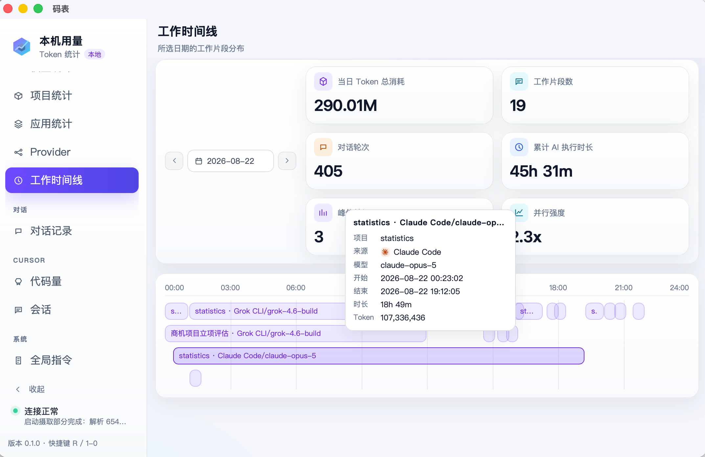
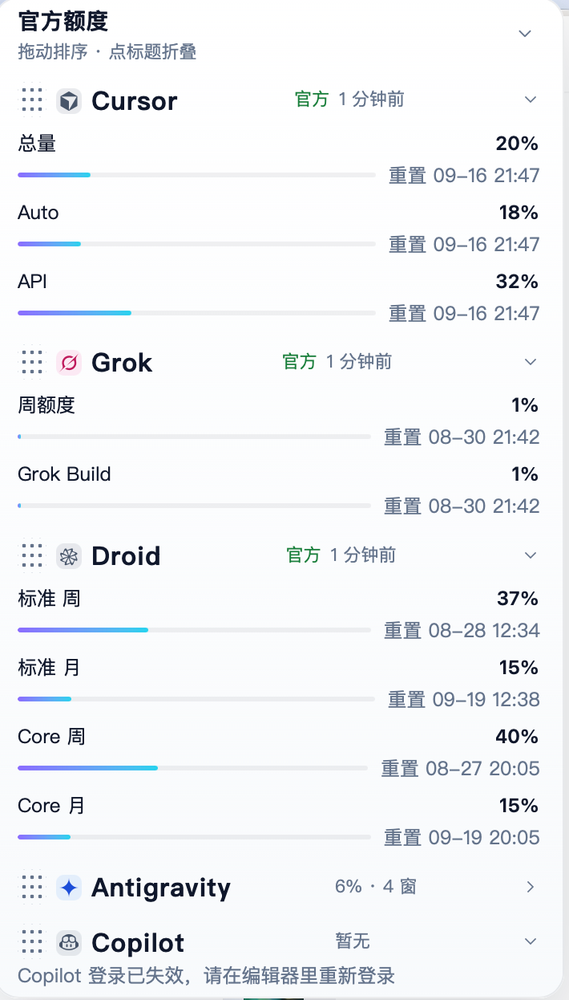

# Mabiao (码表)

[中文](README.md) · [Website](https://mabiao.dev)

A local desktop app that scans AI coding CLI session files on your machine, normalizes them into **usage records**, and shows token usage, a work timeline, and the full event stream. **Read-only by default. Local usage records are not uploaded.**

[](https://github.com/qqzhangyanhua/mabiao/actions/workflows/ci.yml)
[](https://github.com/qqzhangyanhua/mabiao/releases/latest)
[](LICENSE)

<p align="center">
  
</p>

| Work timeline | Conversation events | Menubar quota |
|:---:|:---:|:---:|
|  |  |  |

## Supported sources

Mabiao reads local directories. It does not replace vendor dashboards. **The full list of 35 Usage Sources, default paths, and token dimensions is in [`CONTEXT.md`](CONTEXT.md).** Scan roots can be set as absolute paths in Settings, or overridden with environment variables (Settings wins); see [`docs/adr/0005-configurable-source-paths.md`](docs/adr/0005-configurable-source-paths.md). The table below is a summary, not a complete inventory.

| Source | Local tokens | Local cost | Notes |
|------|:---:|:---:|------|
| Claude Code | ✅ | ✅ | Native `costUSD` |
| Codex | ✅ | ❌ | |
| pi | ✅ | ✅ | |
| OMP | ✅ | ✅ | Native `cost.total`; subagent tokens roll into the parent session |
| opencode | ✅ | ✅ | |
| grok | ✅ | ✅ | |
| Hermes | ✅ | ✅ | Native `actual_cost_usd` |
| Crush | ✅ | ✅ | Native `cost`; root sessions only |
| Aider | ✅ | ✅ | Only the JSONL the user enabled with `--analytics-log` |
| kimi / gemini / dsh / copilot | ✅ | ❌ | dsh needs decompress; copilot totals only at session end |
| Zed | ✅ | ❌ | `threads.db` zstd/json threads; remainder tops the per-request map up to cumulative |
| Cherry Studio | ✅ | ✅ | sqlite `ai_usage_record`; USD cost only |
| OpenClaw | ✅ | ✅ | jsonl `agents/*/sessions`; native `usage.cost.total` |
| CodeBuddy IDE | ✅ | ❌ | conversation-level `statsSnapshot` under `CodeBuddyExtension/Data`; credits are not USD |
| Factory / droid | ✅ | ❌ | Session totals; model from settings; subagents merge into parent |
| Cursor | ⚠️ | ❌ | Code volume + account usage (reads the local client's login state) |
| cursor-agent | ⚠️ | ❌ | Tokens only after a wrapper writes them to disk |
| qwen | ✅ | ❌ | |
| Amp | ✅ | ❌ | `threads/*.json`; credits are not USD |
| Roo Code | ✅ | ✅ | VS Code-family `ui_messages.json`; native `cost` (assumed USD) |
| Kilo Code | ✅ | ✅ | Same shape as Roo; skip `usageMissing` |
| Warp | ✅ | ❌ | `warp.sqlite` session totals; credits are not USD |
| Windsurf | ✅ | ❌ | ACP `usage_update` ndjson; no encrypted Cascade |
| Qoder / Qoder CN | ✅ | ✅ | Claude Code shape; native `costUSD` |
| Cline | ✅ | ✅ | CLI `messages.json`; native `metrics.cost` |
| Goose | ✅ | ❌ | `sessions.db` session totals; skip `hidden` |
| Trae CLI | ✅ | ❌ | Codex rollout shape; includes jsonl.zst |
| WorkBuddy / ZCode / Alma / CodeBuddy | ✅ | varies | See CONTEXT.md |

Dimensions, default paths, and limits: [`CONTEXT.md`](CONTEXT.md).

## Features

- **Overview and breakdowns**: trends by hour / day / week / month; split by source, model, provider, project, and session; export CSV / JSON; save charts as images
- **Work timeline**: lay sessions out as daily segments — duration, turns, and how much you ran in parallel
- **Conversation records**: read local bodies and the event stream on demand (prompt / thought / tool / reply); export Markdown / JSON
- **Quotas stay separate**: local 5-hour / 7-day estimate windows (not official caps) vs **official quota**. Nine built-in accounts — Claude / Codex / Cursor / Grok / Droid / Antigravity / OpenCode / Copilot / Devin — each with its plan label; Settings also accepts custom providers. Official quota rows can estimate time-to-100% from two consecutive snapshots (not the local 5-hour burn). The menubar shows today's spend and the tightest official percentage
- **Global instructions**: lists the user-written instructions each source actually loads, kept out of token KPIs
- **Cursor code volume**: editor AI line counts are a separate dimension, not mixed into token KPIs
- **Local cache**: sqlite backup / restore / per-source rebuild; records stay archived (and counted) after source files rotate away
- **Budget alerts**: optional monthly budget (USD); one system notification per threshold for local estimates or official quota

## Data and privacy

- Default scan is read-only. **Local usage records are not uploaded**
- Aggregates live in local sqlite; backup, restore, or rebuild from Settings
- Cursor account usage and official quota only read login state each client already keeps locally (e.g. Cursor's `state.vscdb`). There is no manual paste path and nothing is written to a keychain; session bodies are not rewritten
- The only keychain read is Antigravity's official quota (the AGY CLI keeps its login state in the macOS Keychain); off macOS it falls back to the client's local state. Local file ingestion never touches a keychain
- Editing global instructions writes the user's own instruction files through a whitelist; see [`docs/adr/0010-writing-user-owned-files.md`](docs/adr/0010-writing-user-owned-files.md)

## Install

GitHub Actions attaches installers to [Releases](https://github.com/qqzhangyanhua/mabiao/releases). The current public release is **[v0.1.4](https://github.com/qqzhangyanhua/mabiao/releases/tag/v0.1.4)**.

| Platform | Artifact |
|------|------|
| macOS Apple Silicon | `.dmg` (`aarch64-apple-darwin`) |
| macOS Intel | `.dmg` (`x86_64-apple-darwin`) |
| Linux x64 | `.deb` / AppImage / `.rpm` |
| Windows x64 | NSIS `.exe` / MSI |

Builds are **unsigned**. On first macOS open, right-click → Open in Finder, or:

```bash
xattr -cr "/Applications/Mabiao.app"
```

Windows SmartScreen may block the installer; choose “Run anyway”. The menubar treats macOS as first-class; Linux / Windows differences are in [`docs/platforms.md`](docs/platforms.md).

## Build from source

Prerequisites:

- Node.js 22.22+
- [pnpm](https://pnpm.io/) 9 (pinned to `pnpm@9.15.0`; do not use npm / yarn)
- [Rust](https://rustup.rs/) stable
- Linux also needs WebKitGTK and related system libs; see [`docs/platforms.md`](docs/platforms.md)

```bash
pnpm install
pnpm tauri dev
```

A native window titled 「码表」 should open. Local installer:

```bash
pnpm tauri build
```

Ship cross-platform packages through the GitHub Release workflow. Do not treat a local `pnpm tauri build` as a release.

## Development

```bash
pnpm lint
pnpm lint:fix
pnpm format
pnpm test       # Vitest (pure functions in src/lib)
pnpm build      # tsc + vite build
```

Re-run local token-field probing (developer machine only):

```bash
cargo run --bin probe --manifest-path src-tauri/Cargo.toml
```

| Doc | What it covers |
|------|------|
| [`CONTEXT.md`](CONTEXT.md) | Domain terms and per-source coverage |
| [`docs/platforms.md`](docs/platforms.md) | Cross-platform build and release |
| [`docs/adr/`](docs/adr/) | Architecture decisions |
| [`AGENTS.md`](AGENTS.md) | How to test and add an adapter |
| [`docs/probe/`](docs/probe/) | Local field-probe notes |

## Contributing

Issues and PRs are welcome. See [`AGENTS.md`](AGENTS.md) for adding a source and for the verification steps. Open PRs as drafts and mark ready after CI is green.

## License

[MIT](LICENSE)
